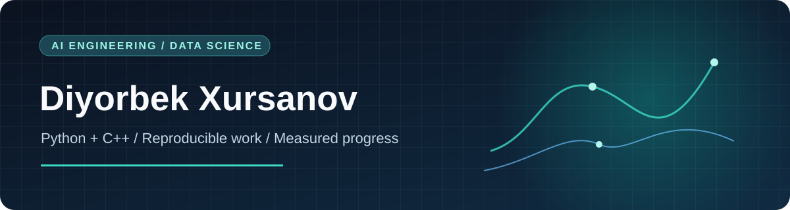

  

  <strong>Python · C++ · AI engineering · Data science</strong>

I am Diyorbek Xursanov, building a foundation in AI engineering and data science through code, experiments, and careful evaluation. I use Python and C++ and am developing the statistical, machine learning, and systems skills needed to build dependable AI software.

## Direction

| Area | What I am working toward |
| --- | --- |
| Data science | Clean data, sound analysis, reproducible experiments, and honest interpretation. |
| Machine learning | Baselines, valid evaluation, error analysis, and documented tradeoffs. |
| AI engineering | Reliable applications with measured behavior, clear limits, and human oversight. |
| Systems | C++ fundamentals, algorithms, performance measurement, and efficient inference. |

## Learning in public

My [roadmap through May 2027](./ROADMAP.md) defines concrete monthly deliverables and a daily practice rhythm. The goal is to publish work that another person can run, inspect, and question. I will link finished, reproducible projects here as they are ready.

## Public work

- [C++ matrix foundations](https://github.com/XursanovDiyorbek/cpp-ai-data-science-core) — a small C++17 module for transpose, multiplication, and diagonal sums, with shape validation and automated tests. The README states its scope and limitations.

**Current focus:** build a reproducible Python data analysis with a documented dataset, baseline, tests, and honest limitations.

## Engineering standard

For public work, I aim to include a clear problem statement, reproducible setup, data provenance, an appropriate baseline, tests, results, and limitations. Progress is reflected in the work itself, not in badges or a contribution count.

Uzbekistan · Open to learning, collaboration, and thoughtful review.

